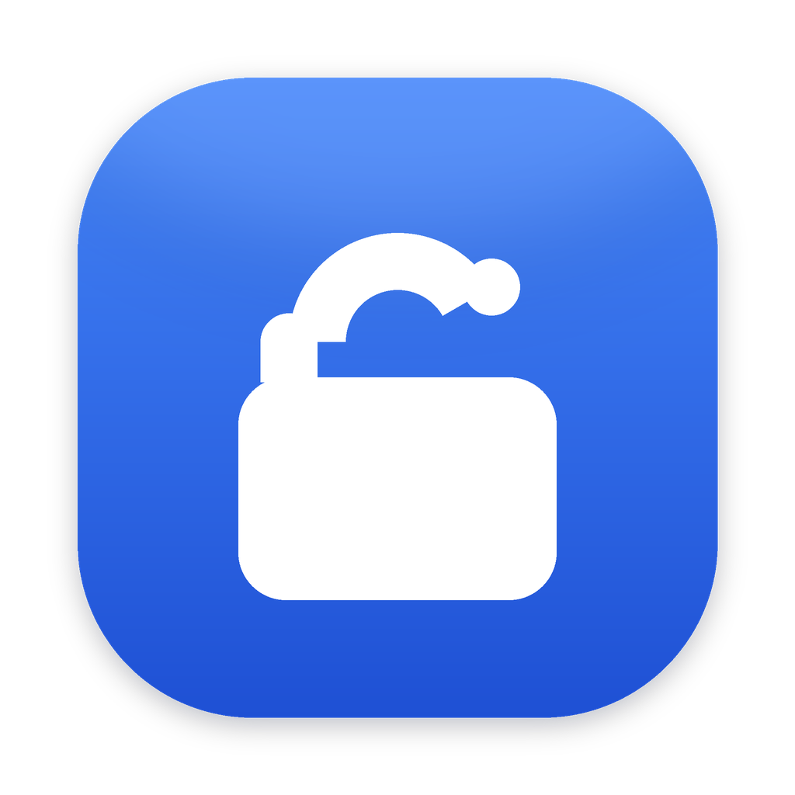
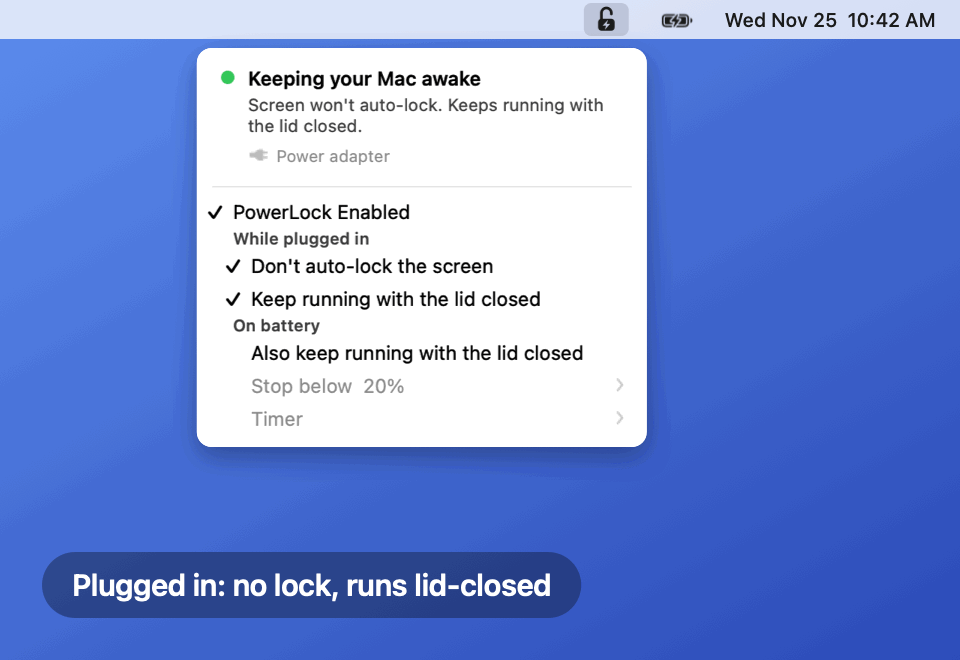
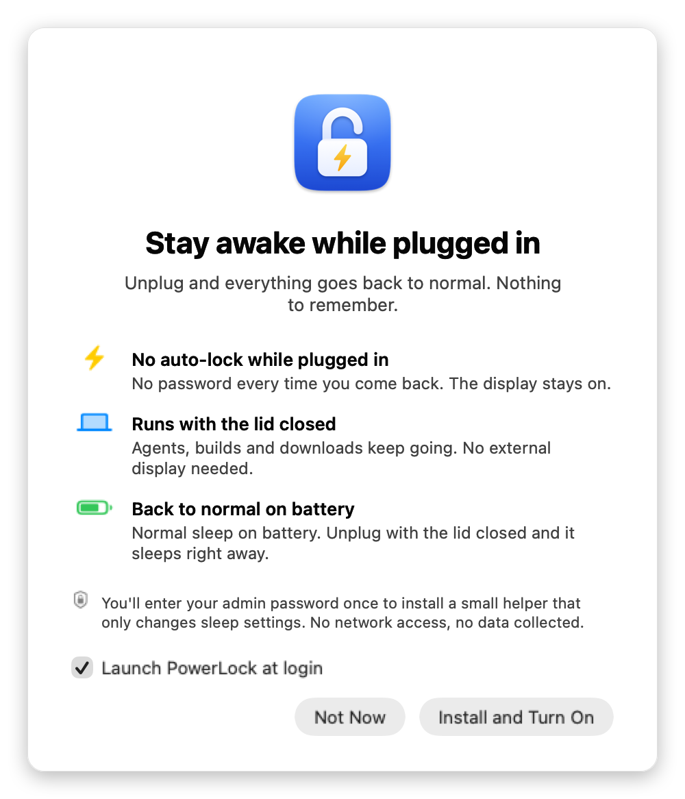
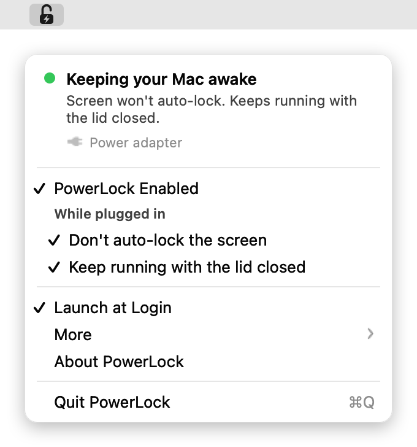

# PowerLock

[中文](README.md)

[](https://github.com/pandengyao/PowerLock/releases/latest)
[](https://github.com/pandengyao/PowerLock/actions/workflows/build.yml)

[](LICENSE)

> While plugged in, your Mac stays unlocked and keeps running with the lid closed. Unplug it and normal sleep comes back on its own. Set it up once and forget it.

<p align="center"></p>

PowerLock is a small macOS menu bar app for people who:

- close the lid and want Claude Code, Codex or other AI coding agents, builds, downloads or training scripts to keep running, without an external display
- use a MacBook as a desktop and are tired of typing the password every time they come back
- need the Mac to stay reachable over SSH, remote desktop or a tunnel

What it does:

- **No auto-lock on AC power**: the display stays on and the screen saver does not start, so the screen never locks itself
- **Keeps running with the lid closed on AC power**: no external display, keyboard or mouse needed
- **Restores normal behavior on battery**: system sleep settings come back. If the lid is already closed when you unplug, the Mac goes to sleep right away instead of staying awake in your bag
- **No switch to remember**: it follows the power source automatically. You can turn it off or uninstall it from the menu bar at any time

<p align="center"></p>

## How it compares

- **KeepingYouAwake, `caffeinate`**: prevent idle sleep, but closing the lid still sleeps the Mac ([KeepingYouAwake FAQ](https://github.com/newmarcel/KeepingYouAwake#does-it-work-on-a-macbook-with-a-closed-lid))
- **Amphetamine**: feature-rich, closed source (App Store). Its closed-display mode relies on the separate Amphetamine Enhancer for a fail-safe
- **[Sleepless](https://github.com/Aboudjem/Sleepless)**: open source, supports lid-closed on battery with a timer and a battery floor. You switch it on by hand
- **PowerLock**: switches on and off with the power adapter, so it fits a Mac that is plugged in most of the time. It also handles screen locking. It deliberately does not keep the Mac awake with the lid closed on battery

## Requirements

- macOS 13 Ventura or later
- Apple Silicon or Intel (universal binary)
- An admin account for the first setup (installs a background helper)

## Install

### Homebrew

```bash
brew install --cask pandengyao/tap/powerlock
```

If Homebrew says the tap is not trusted, run `brew trust --cask pandengyao/tap/powerlock` first.

### Download

1. Download `PowerLock-<version>.dmg` from [Releases](https://github.com/pandengyao/PowerLock/releases/latest)
2. Drag `PowerLock.app` into Applications
3. PowerLock is not notarized yet. If macOS says it cannot verify the developer, open **System Settings → Privacy & Security**, click **Open Anyway**, then open PowerLock again

### Build from source

Only the Xcode Command Line Tools are needed:

```bash
xcode-select --install
git clone https://github.com/pandengyao/PowerLock.git
cd PowerLock
./scripts/build.sh
open build/PowerLock.app
```

On first launch, click **Install and Turn On** in the welcome window and enter your admin password once.

<p align="center"></p>

## Using it

PowerLock lives in the menu bar. Click the lock to see what it's doing:

<p align="center"></p>

The menu bar icon:

- **Open lock with a bolt**: working (plugged in)
- **Open lock, hollow**: on, but paused because you're on battery
- **Closed lock**: off
- **Dot in the corner**: setup isn't finished, or the helper needs an update

In the menu, **PowerLock Enabled** is the main switch, and the two options under **While plugged in** can be turned on and off separately. **More** has Lock Screen settings, updates, diagnostics, issue reporting and uninstall.

The UI follows your system language: Simplified Chinese if that comes first in your preferred languages, English otherwise.

## How it works

The "require password" setting in macOS is a global policy that a normal app cannot change. PowerLock works around it:

1. On AC power it stops the screen saver from starting and keeps the display awake, so the lock never triggers
2. On AC power with lid mode on, the helper runs `pmset -a disablesleep 1`
3. On battery, or when you turn it off, the helper restores `disablesleep 0` and your display sleep time. macOS only checks the lid when it opens or closes or the power source changes, so if the lid is already closed at that point (and no external display is connected), the helper runs `pmset sleepnow`

The helper is a launchd daemon (`com.powerlock.helper`) bundled with the app and installed by it:

- The app itself runs with your user permissions
- The helper runs as root and only changes sleep settings (fixed `pmset` commands). It does not use the network and only reads PowerLock's own config and state files
- It only turns `disablesleep` off if PowerLock turned it on, so it does not fight your own settings or other tools
- The menu bar updates instantly through IOKit power notifications. The helper checks the power source every 5 seconds, so settings are restored within about 5 seconds of unplugging

See [SECURITY.md](SECURITY.md) for the full permission model.

## Uninstall

1. Menu bar → PowerLock → More → **Uninstall PowerLock…**. The app removes the helper, restores sleep settings and quits
2. Move `PowerLock.app` to the Trash

If you installed with Homebrew, either remove the helper from the menu first and then run `brew uninstall --cask powerlock`, or run `brew uninstall --zap --cask powerlock`, which also stops and removes the helper.

Manual cleanup if the app is already gone:

```bash
sudo launchctl bootout system/com.powerlock.helper 2>/dev/null
sudo rm -f /Library/LaunchDaemons/com.powerlock.helper.plist \
           /Library/PrivilegedHelperTools/com.powerlock.helper
sudo rm -rf "/Library/Application Support/PowerLock"
sudo pmset -a disablesleep 0
rm -f ~/Library/LaunchAgents/com.powerlock.login.plist
rm -rf ~/Library/Application\ Support/PowerLock
```

## FAQ

**Why does it need an admin password?**
Only root can change `pmset disablesleep`. A small helper does this, and you authorize it once. It only asks again when the helper itself gets an update.

**Does it keep working after I quit the app?**
Lid-closed mode is handled by the helper and keeps working. The no-lock option needs the app running: when you quit, screen saver and display sleep go back to your system settings.

**Why does the display stay on while plugged in?**
Because display sleep triggers the lock screen. If you only want lid-closed mode, turn off the no-lock option.

**Can it keep the Mac awake with the lid closed on battery?**
No, on purpose: airflow is poor with the lid closed and the battery drains quickly. Use [Sleepless](https://github.com/Aboudjem/Sleepless) if you need that.

**Does it collect data?**
No. It only contacts the GitHub Releases API when you click "check for updates". Settings stay on your Mac.

## License

[MIT](LICENSE)
