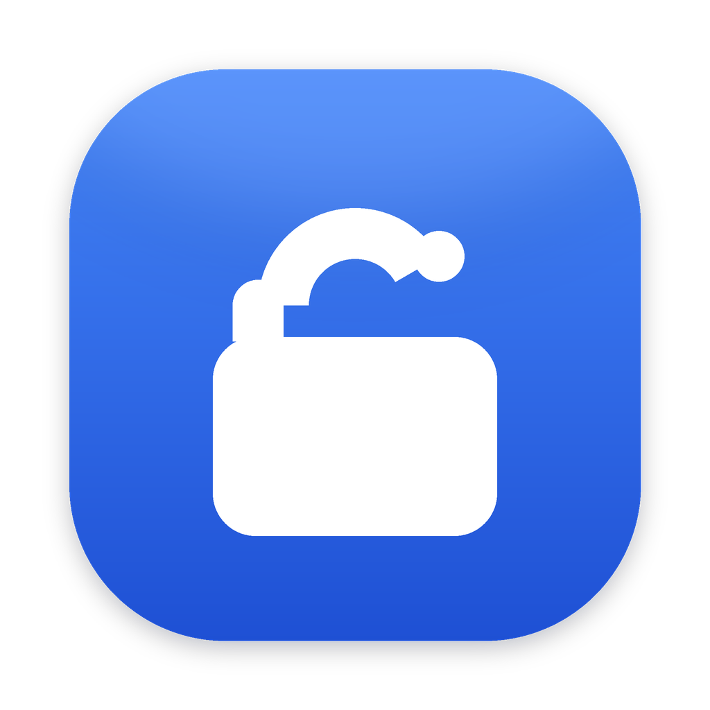
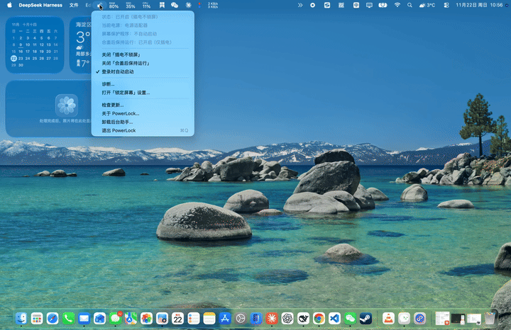
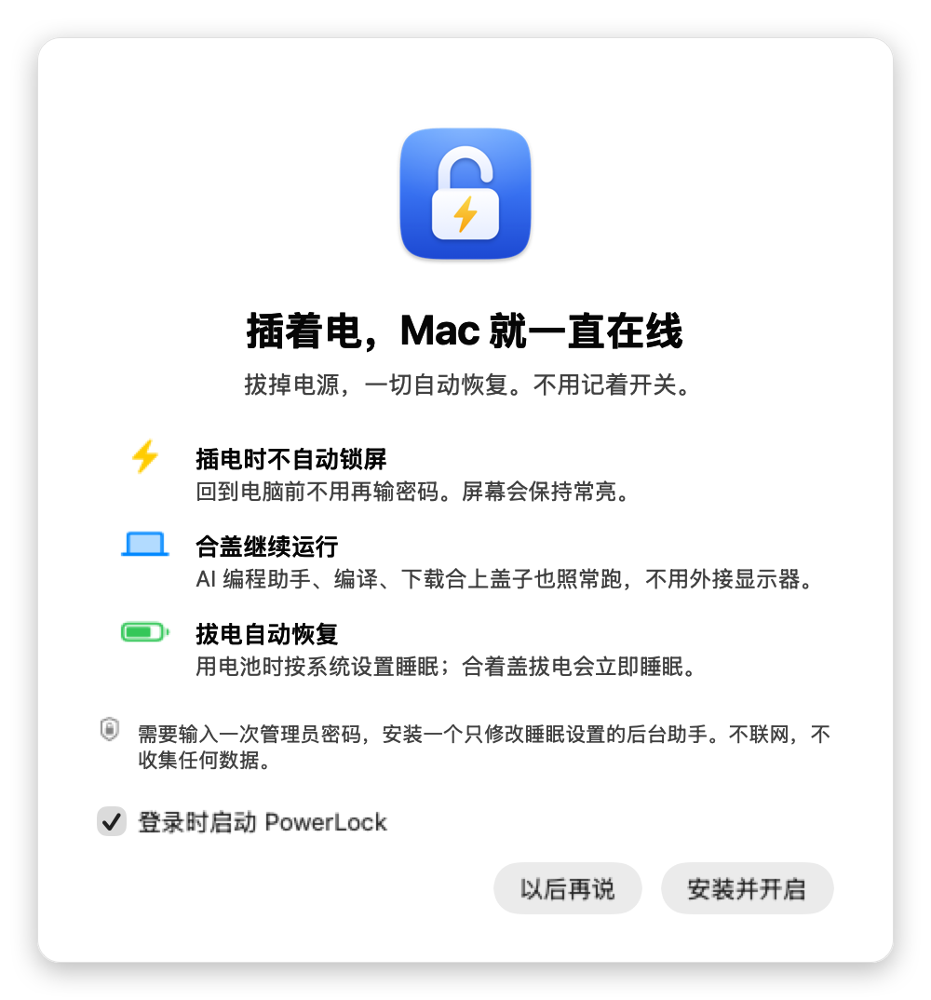
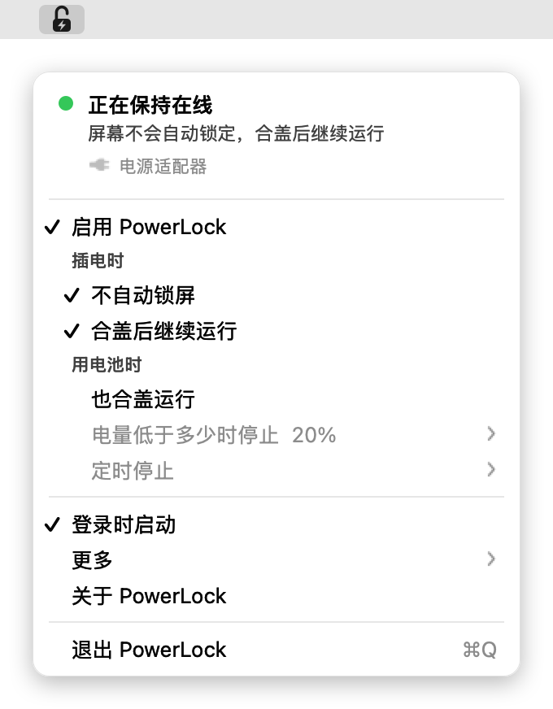

# PowerLock

[English](README.en.md)

[](https://github.com/pandengyao/PowerLock/releases/latest)
[](https://github.com/pandengyao/PowerLock/actions/workflows/build.yml)

[](LICENSE)

> 插电时 Mac 不锁屏、合盖继续运行；拔电后自动恢复系统默认。装好以后不用再管。

<p align="center"></p>

PowerLock 是一个 macOS 菜单栏小工具，适合这些情况：

- 合上盖子让 Claude Code、Codex 等 AI 编程助手、编译、下载、训练脚本继续跑，又不想接外接显示器
- 把笔记本当台式机用，插着电不想每次回来都输密码
- 远程连接、SSH、内网穿透需要 Mac 一直在线

它做的事：

- **插电不锁屏**：插电时屏幕保持常亮、屏幕保护程序不自动启动，所以不会自动锁屏
- **插电合盖继续运行**：不需要外接显示器、键盘和鼠标
- **拔电自动恢复**（默认）：用电池时恢复系统默认睡眠设置；如果拔电时盖子是合着的，Mac 会立即睡眠，不会在包里一直耗电
- **可选：用电池时也合盖运行**：默认关闭。打开后用电池时也不自动睡眠，电量低于下限（默认 20%）、开了低电量模式或到了定时时间会自动停止
- **不用手动开关**：根据电源自动切换；菜单栏可以随时关闭，或一键卸载

<p align="center"></p>

> 演示：插着电时图标带闪电，正在生效；拔电后变成空心，暂停并按系统设置睡眠；插回后自动恢复；随时可以在菜单里关掉。

## 和同类工具的区别

- **KeepingYouAwake、`caffeinate`**：阻止空闲睡眠，但合上盖子仍会睡眠（[KeepingYouAwake 的说明](https://github.com/newmarcel/KeepingYouAwake#does-it-work-on-a-macbook-with-a-closed-lid)）
- **Amphetamine**：功能多，闭源（App Store）；合盖模式的失效保护需要另装 Amphetamine Enhancer
- **[Sleepless](https://github.com/Aboudjem/Sleepless)**：开源，支持用电池时合盖运行，有定时和电量下限；需要手动打开
- **PowerLock**：按电源自动开关，插上电就生效、拔掉就恢复，适合长期插电的场景；同时处理锁屏；用电池时合盖运行是可选项，默认关闭

## 系统要求

- macOS 13 Ventura 或更新版本
- Apple Silicon 或 Intel Mac（universal binary）
- 首次启用需要管理员账号（安装后台助手）

## 安装

### 方式一：Homebrew

```bash
brew install --cask pandengyao/tap/powerlock
```

如果 Homebrew 提示 tap 未受信任，先运行 `brew trust --cask pandengyao/tap/powerlock`。

PowerLock 还没有做苹果公证，用 Homebrew 装的第一次打开也会提示"Apple 无法验证"，处理方法和下面的方式二第 3 步一样。

### 方式二：下载安装包

1. 从 [Releases](https://github.com/pandengyao/PowerLock/releases/latest) 下载 `PowerLock-<版本>.dmg`
2. 打开 dmg，把 `PowerLock.app` 拖进「应用程序」
3. 首次打开如果系统提示无法验证开发者（PowerLock 还没有做苹果公证）：
   - 打开「系统设置 → 隐私与安全性」
   - 在「安全性」区域点「仍要打开」
   - 再打开一次 PowerLock

### 方式三：源码构建

只需要 Xcode Command Line Tools，不需要完整 Xcode：

```bash
xcode-select --install
git clone https://github.com/pandengyao/PowerLock.git
cd PowerLock
./scripts/build.sh
open build/PowerLock.app
```

### 首次启动

首次启动会显示引导窗口，点「安装并开启」，输入一次管理员密码。

<p align="center"></p>

## 使用

启动后菜单栏会出现一个锁形图标，点开可以看到当前状态和开关：

<p align="center"></p>

菜单栏图标：

- **打开的锁，带闪电**：正在生效（插着电，或者「用电池时也合盖运行」正在运行）
- **打开的锁，空心**：已开启，但正在用电池，暂停中（包括「用电池时也合盖运行」因电量低、低电量模式或定时自动停止后）
- **合上的锁**：已关闭
- **右上角有圆点**：还没完成设置，或后台助手需要更新

菜单里：

- **启用 PowerLock**：总开关
- **插电时 → 不自动锁屏 / 合盖后继续运行**：两个功能可以分别开关
- **用电池时 → 也合盖运行**：默认关闭，要先开「合盖后继续运行」；下面可以设电量下限（10%～50%）和定时停止（1、2、4 小时）
- **更多**：系统「锁定屏幕」设置、检查更新、诊断信息、反馈问题、卸载

界面语言跟随系统：首选语言是简体中文时显示中文，其他情况显示英文。

## 工作原理

macOS 的「需要密码」是全局策略，普通 App 无法直接修改。PowerLock 的做法是：

1. 插电时把「屏幕保护程序」设为不自动启动，并让插电时显示器不休眠，屏幕保持常亮，自然不会触发锁屏
2. 插电且开启合盖运行时，后台助手执行 `pmset -a disablesleep 1`
3. 用电池或关闭功能时，助手恢复 `disablesleep 0` 和原来的显示器休眠时间。系统只在开合盖、插拔电源时检查盖子，所以如果这时盖子合着（且没有外接显示器），助手会执行 `pmset sleepnow` 让 Mac 睡眠
4. 打开了「用电池时也合盖运行」时，用电池也保持 `disablesleep 1`，但显示器休眠照常恢复。助手每次检查都读一遍内置电池电量（`pmset -g batt`）和低电量模式，电量低于下限、开了低电量模式、到了定时时间或读不到电量，就按第 3 步恢复睡眠。停止以后盖子合着时不会自己重新打开，要开盖或插电

后台助手是 App 内置、由 App 安装的 launchd 服务（`com.powerlock.helper`）：

- App 本体只以你的用户权限运行
- 助手以 root 运行，只改睡眠相关的系统设置（固定的 `pmset` 命令），不联网；只读取 PowerLock 自己的配置和状态文件
- `disablesleep` 只有是 PowerLock 自己打开的才会被它关闭，不影响你手动或其他工具的设置
- 菜单栏通过 IOKit 电源通知即时更新；助手每 5 秒检查一次电源，所以拔电后最多约 5 秒恢复（打开了「用电池时也合盖运行」时除外）

详细的权限说明见 [SECURITY.md](SECURITY.md)。

## 卸载

推荐流程：

1. 菜单栏 PowerLock → 更多 → **卸载 PowerLock…**
2. 确认后 App 会停止并删除助手、恢复系统睡眠设置、退出
3. 把 `PowerLock.app` 从「应用程序」移到废纸篓

用 Homebrew 安装的，可以先按上面第 1 步在菜单里卸载助手，再 `brew uninstall --cask powerlock`；或者直接 `brew uninstall --zap --cask powerlock`，会同时停止并删除后台助手。

如果 App 已经删除，可以手动清理：

```bash
sudo launchctl bootout system/com.powerlock.helper 2>/dev/null
sudo rm -f /Library/LaunchDaemons/com.powerlock.helper.plist \
           /Library/PrivilegedHelperTools/com.powerlock.helper
sudo rm -rf "/Library/Application Support/PowerLock"
sudo pmset -a disablesleep 0
rm -f ~/Library/LaunchAgents/com.powerlock.login.plist
rm -rf ~/Library/Application\ Support/PowerLock
```

## 常见问题

**为什么需要管理员密码？**
合盖运行（`pmset disablesleep`）只有 root 能改。PowerLock 用一个很小的后台助手完成这件事，安装时授权一次。之后只有助手本身有更新时才会再请求一次。

**为什么插电时屏幕一直亮着？**
系统「需要密码」是全局设置，显示器一旦休眠就会锁屏。要保持不锁屏，只能让屏幕保持常亮。不需要的话可以只开「合盖后继续运行」。

**拔电后会不会一直耗电？**
默认不会。助手检测到电池供电后会在 5 秒内恢复 `disablesleep 0`、屏幕保护和显示器休眠设置；如果盖子合着，Mac 会立即睡眠。打开了「用电池时也合盖运行」的话，会一直运行到电量低于下限、开了低电量模式或到了定时时间。

**用电池时能合盖运行吗？**
可以，在菜单里打开「用电池时 → 也合盖运行」，默认是关的。合盖后散热比开盖差，长时间满负载会明显发热，所以 PowerLock 会在电量低于下限（默认 20%）、开了低电量模式或到了定时时间时自动停止，让 Mac 正常睡眠。定时只管这个选项，到时间后选项自动关掉，插电时的行为不受影响。

**退出 PowerLock 后还生效吗？**
「合盖后继续运行」和「用电池时也合盖运行」由后台助手负责，退出 App 后仍然生效。「插电不锁屏」需要 App 在运行：退出 App 后，屏幕保护和显示器休眠都会恢复系统设置。想完全停用，在菜单里关闭或卸载后台助手。

**为什么没有系统通知横幅？**
PowerLock 还没有开发者签名，macOS 不允许它发送通知。所有状态都在菜单栏和诊断窗口里。

**会收集数据吗？**
不会。只有在你手动点击「检查更新」时请求 GitHub Releases API；配置只保存在本机。

## 开发

```bash
./scripts/build.sh             # 构建到 build/PowerLock.app
UNIVERSAL=1 ./scripts/build.sh # universal 构建
./scripts/check.sh             # 语法/plist/构建/CLI 冒烟检查
./Tests/helper-test.sh         # 用 mock pmset/ioreg 测试助手状态机
./scripts/verify.sh            # 安装后验收（助手、pmset、屏保、登录项）
VERSION=1.1.0 ./scripts/package.sh  # zip + dmg + SHA256
```

目录结构：

```
Sources/           App 源码（Swift）
Resources/         Info.plist、图标、后台助手与安装脚本
scripts/           构建、打包、检查、图标生成
Tests/             助手逻辑测试
docs/              路线图、发布清单、Homebrew 模板、图片
.github/workflows/ CI
```

后续计划见 [路线图](docs/ROADMAP.md)，贡献方式见 [CONTRIBUTING.md](CONTRIBUTING.md)。

## License

[MIT](LICENSE)
